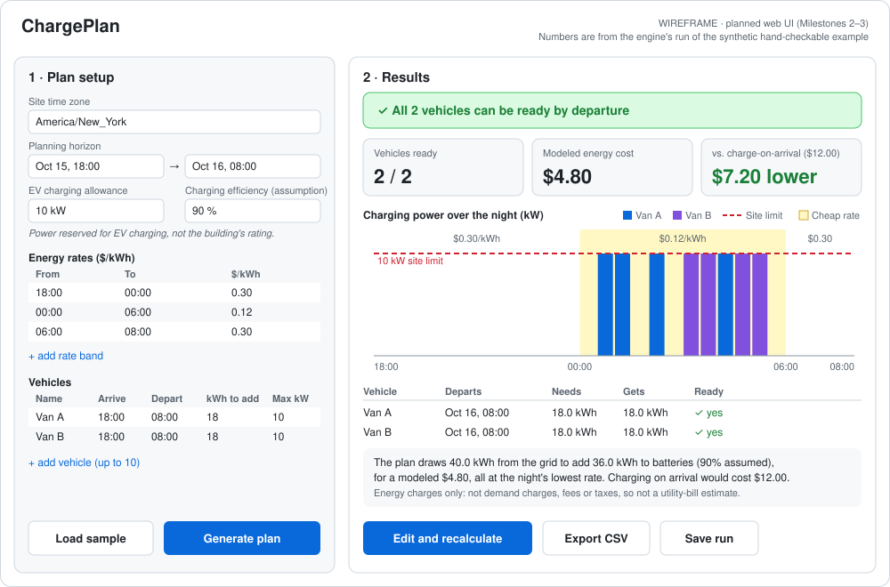

# ChargePlan

**Plan tonight's EV charging for a small fleet: will every vehicle be ready, and what will it cost?**

ChargePlan is a planning simulator for a depot with 3–10 electric vehicles. You enter when each vehicle arrives and leaves,
how much energy it needs, the electricity rates through the night, and how much power the depot can spend on charging.
ChargePlan works out **when to charge each vehicle** so they're all ready at the **lowest modeled energy cost**, without
going over the depot's power limit. It also tells you plainly when that's impossible.

> **Status: early prototype.** Milestone 1 of 5 (the Python planning engine) is done. All data is **synthetic**.
> No customer interviews have been completed yet. ChargePlan does not connect to or control real chargers.


<sub>*Wireframe of the web UI planned for Milestones 2–3. Its numbers come from the engine's real run of the synthetic example below.*</sub>

## Try it in 2 minutes

You need Python 3.12 or newer.

```bash
git clone https://github.com/aryamanarora512/chargeplan.git
cd chargeplan/backend
python3 -m venv .venv
source .venv/bin/activate
pip install -r requirements-dev.txt

python -m pytest -q                       # run the tests
python -m chargeplan.cli                  # list the demo scenarios
python -m chargeplan.cli hand_checkable   # plan one and print a report
```

Real output (trimmed) for the hand-checkable example:

```text
STATUS: OPTIMAL

                           Optimized   Baseline*
  Vehicles ready                 2/2         2/2
  Grid energy (kWh)            40.00       40.00
  Energy cost                  $4.80      $12.00
  Savings vs baseline   $7.20 (60.0%)
  * Baseline = charging as soon as vehicles arrive, earliest departure first.

Optimized schedule (kW per 30-minute slot; # = share of site limit):
  Time    $/kWh     v1     v2   Total  Limit
  23:30    0.30    0.0    0.0     0.0     10
  00:00    0.12    0.0    0.0     0.0     10
  00:30    0.12   10.0    0.0    10.0     10  ####################
  01:00    0.12   10.0    0.0    10.0     10  ####################
  ...

What this means:
  - All 2 vehicles can be ready by departure under these inputs.
  - The optimized plan draws 40.0 kWh from the grid to add 36.0 kWh to batteries (assuming 90% charging
    efficiency), for a modeled energy cost of $4.80. ...
  - Costs cover charging energy at the entered rates only (no demand charges, fixed fees or taxes),
    so they are not a utility-bill estimate.
```

## The example, by hand

Two vans arrive at 18:00 and leave at 08:00. Each needs **18 kWh** in its battery. At an assumed 90% charging efficiency,
that means **20 kWh from the grid** each. Each charger allows 10 kW, but the depot allows only **10 kW in total**.
Synthetic rates: $0.30/kWh until midnight, **$0.12/kWh from 00:00–06:00**, then $0.30/kWh again.

- **Charge on arrival** (the baseline): Van A charges 18:00–20:00, then Van B 20:00–22:00. 40 kWh × $0.30 = **$12.00**.
- **ChargePlan**: 40 kWh at 10 kW takes 4 hours, which fits inside the 6 cheap hours. 40 kWh × $0.12 = **$4.80**.

The $7.20 difference comes only from these invented prices. It is not evidence of real savings or a smaller utility bill.

## How it works

1. **Validate** the inputs. Times must sit on 30-minute boundaries, rates must cover the whole night with no gaps or
   overlaps, and nights with a daylight-saving clock change are rejected (for now).
2. **Split the night** into 30-minute slots and mark when each vehicle is plugged in.
3. **Baseline:** charge as soon as possible, serving the earliest departure first. This is a benchmark only.
4. **Optimize:** a *linear program* (minimize Σ price × energy, subject to charger, availability, site-limit and energy
   requirements), solved by [HiGHS](https://highs.dev) through `scipy.optimize.linprog`.
5. **Verify** the returned schedule against every rule ourselves before calling any vehicle "ready."
6. **Explain** the result in plain language. Savings are only shown when both plans deliver the same energy.

The full explanation, with a two-slot example you can solve on paper, is in **[docs/model.md](docs/model.md)**.

## Demo scenarios (all synthetic)

| Scenario | What it shows |
|---|---|
| `hand_checkable` | The $12.00 vs $4.80 example above |
| `flat_rates` | One flat price all night gives exactly $0 savings |
| `early_departure` | A van leaving at 23:00 must pay the evening rate |
| `baseline_misses_departure` | Charge-on-arrival leaves a van 12.6 kWh short; the optimizer readies both |
| `not_enough_time` | Impossible: one van can't get enough energy in 3 hours, and ChargePlan says exactly why |
| `evening_conflict` | Impossible: each van is fine alone, but they compete for shared power |
| `full_depot` | Largest supported size: 10 vans × 48 half-hour slots |

## Evaluation (measured, not estimated)

- **Tests:** 83 passing (`python -m pytest -q`). They cover cost and efficiency arithmetic, every constraint, the worked
  example, flat rates, zero energy, impossible requests, baseline-fails-but-optimizer-succeeds, tariff gaps and overlaps,
  bad numbers, daylight-saving rejection, solver timeouts and errors, and totals matching the per-slot schedule.
  Constraint checks in the tests are written independently of the engine's own checker.
- **Speed:** at the largest supported size (10 vehicles × 48 slots), the median `run_plan` time was **3.4 ms** and the
  slowest was **4.0 ms** over 100 runs. Measured on an Apple M3 Pro (18 GB) running macOS 26.3.1 with Python 3.13.5,
  NumPy 2.5.4, and SciPy 1.18.1, on 2026-10-15. The provisional target is under 2 s. Reproduce with `python -m chargeplan.benchmark`.
- **Customer evidence:** none yet. See [docs/discovery.md](docs/discovery.md).

## What it does *not* do (yet, or on purpose)

- No demand charges, fixed fees, taxes, solar, vehicle-to-grid, battery aging, or charging taper. **Costs are modeled
  charging-energy costs, not utility bills.**
- No real charger control. Chargers have minimum currents and control limits this model ignores.
- One depot, up to 10 vehicles, one window per vehicle, a dedicated charger per vehicle, and a horizon of up to 24 hours.
- No nights with a daylight-saving change (rejected with a clear message).

## Project layout

```text
backend/
  chargeplan/
    engine/            pure planning code: no web, database or UI
      models.py        input data types (vehicles, rate bands, plan)
      validate.py      input checks -> list of plain-language issues
      slots.py         30-minute slots and the plugged-in grid
      baseline.py      charge-on-arrival, earliest-departure-first benchmark
      optimizer.py     the linear program (SciPy linprog + HiGHS)
      checks.py        independent schedule verification and simple impossibility proofs
      summary.py       costs, comparison, plain-language explanation
      planner.py       run_plan(): the one entry point that ties it all together
    scenarios.py       synthetic demo scenarios
    cli.py             terminal report
    benchmark.py       latency measurement
  tests/               pytest suite
docs/
  product-brief.md     problem, customer hypotheses, alternatives, success criteria, wireframe
  model.md             the math, explained with small examples
  discovery.md         customer interview plan and log
  decision-log.md      why things are the way they are
```

## Roadmap

| Milestone | What | Status |
|---|---|---|
| 0 | Product brief and discovery plan | ✅ Done |
| 1 | Python engine + tests | ✅ Done |
| 2 | FastAPI + one editable React form, real results | Next |
| 3 | Charts, error and infeasible states, comparison, CSV export, mobile layout | Planned |
| 4 | Saved plans in PostgreSQL, Docker Compose, CI on the full stack | Planned |
| 5 | Public demo (synthetic examples only, no saved data), demo script | Planned |

**Deployment path.** The engine runs behind a small stateless HTTP API. That one API can serve a website (static React
build plus a hosted Python service) and, later, an iOS app. No hosting has been chosen yet, and no paid services are used.

## Sources

- U.S. DOE FEMP, [Managed EV Charging for Federal Fleets](https://www.energy.gov/cmei/femp/managed-ev-charging-federal-fleets)
- U.S. DOE AFDC, [Electric Vehicles for Fleets](https://afdc.energy.gov/vehicles/electric-fleets)
- SciPy, [`linprog(method="highs")`](https://docs.scipy.org/doc/scipy/reference/optimize.linprog-highs.html)
- Shaffery, Yang & Zhang (2020), [Bayesian Structural Time Series for Behind-the-Meter Photovoltaic Disaggregation](https://research-hub.nlr.gov/en/publications/bayesian-structural-time-series-for-behind-the-meter-photovoltaic-2/)

These sources support the problem framing and the method. None of them shows that there is demand for ChargePlan specifically.
