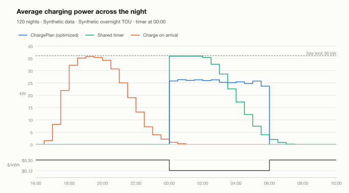
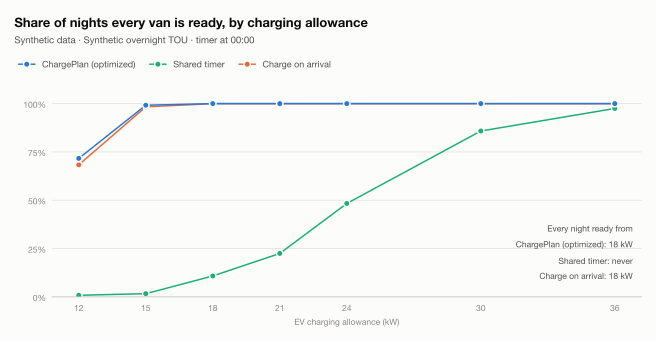
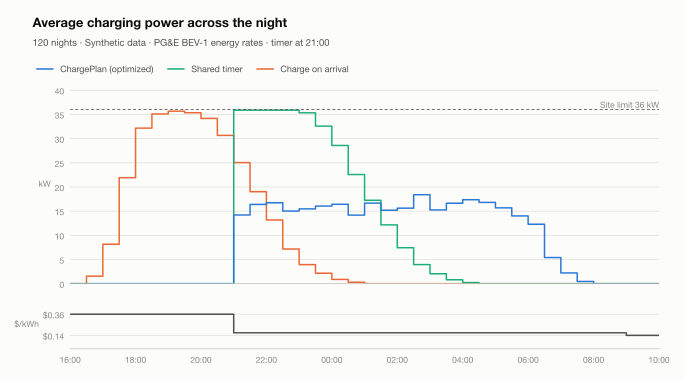
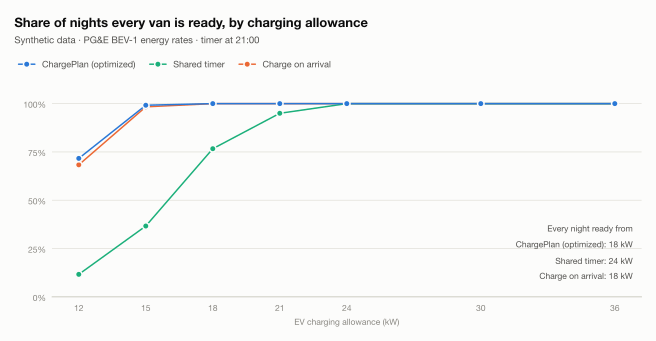
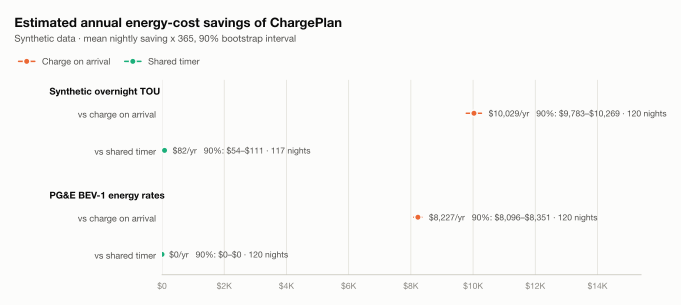

# Savings report

**Data:** Synthetic 6-van history (120 nights). NOT real fleet data.  
**Site:** America/Los_Angeles, nightly plan 16:00 + 18 h, EV charging allowance 36 kW, efficiency 90%  
**Sessions:** 651

Costs are modeled **energy charges only** (no demand or subscription charges, fees, or taxes). Savings are compared only on nights where both plans ready every van, so both deliver the same energy.

## Synthetic overnight TOU

*Invented prices used in the hand-checkable example. Not a real tariff.* Shared timer starts at 00:00.

Nights: 120 total, 120 usable, 0 impossible even for the optimizer, 0 sessions dropped by conservative rounding.

| Policy | Nights every van ready | Mean energy cost on those nights |
|---|---:|---:|
| ChargePlan (optimized) | 120/120 | $18.39 |
| Shared timer | 117/120 | $18.49 |
| Charge on arrival | 120/120 | $45.87 |

| ChargePlan savings | Per night | Per year (x365) | 90% interval | Nights compared |
|---|---:|---:|---:|---:|
| vs charge on arrival | $27.48 | $10,029 | $9,783–$10,269 | 120 |
| vs shared timer | $0.22 | $82 | $54–$111 | 117 |

<picture><source media="(prefers-color-scheme: dark)" srcset="power-profile-synthetic_tou-dark.svg"></picture>

Share of nights every van is ready, by EV charging allowance:

| Allowance | ChargePlan (optimized) | Shared timer | Charge on arrival |
|---:|---:|---:|---:|
| 12 kW | 72% | 1% | 68% |
| 15 kW | 99% | 2% | 98% |
| 18 kW | 100% | 11% | 100% |
| 21 kW | 100% | 22% | 100% |
| 24 kW | 100% | 48% | 100% |
| 30 kW | 100% | 86% | 100% |
| 36 kW | 100% | 98% | 100% |

<picture><source media="(prefers-color-scheme: dark)" srcset="readiness-synthetic_tou-dark.svg"></picture>

## PG&E BEV-1 energy rates

*PG&E Schedule BEV, BEV-1, effective 2026-03-01; energy charges only.* Shared timer starts at 21:00.

Nights: 120 total, 120 usable, 0 impossible even for the optimizer, 0 sessions dropped by conservative rounding.

| Policy | Nights every van ready | Mean energy cost on those nights |
|---|---:|---:|
| ChargePlan (optimized) | 120/120 | $25.30 |
| Shared timer | 120/120 | $25.30 |
| Charge on arrival | 120/120 | $47.84 |

| ChargePlan savings | Per night | Per year (x365) | 90% interval | Nights compared |
|---|---:|---:|---:|---:|
| vs charge on arrival | $22.54 | $8,227 | $8,096–$8,351 | 120 |
| vs shared timer | $0.00 | $0 | $0–$0 | 120 |

<picture><source media="(prefers-color-scheme: dark)" srcset="power-profile-pge_bev1-dark.svg"></picture>

Share of nights every van is ready, by EV charging allowance:

| Allowance | ChargePlan (optimized) | Shared timer | Charge on arrival |
|---:|---:|---:|---:|
| 12 kW | 72% | 12% | 68% |
| 15 kW | 99% | 37% | 98% |
| 18 kW | 100% | 77% | 100% |
| 21 kW | 100% | 95% | 100% |
| 24 kW | 100% | 100% | 100% |
| 30 kW | 100% | 100% | 100% |
| 36 kW | 100% | 100% | 100% |

<picture><source media="(prefers-color-scheme: dark)" srcset="readiness-pge_bev1-dark.svg"></picture>

## Estimated annual savings

<picture><source media="(prefers-color-scheme: dark)" srcset="savings-dark.svg"></picture>

## How to read this

- **Per year** = average saving per comparable night x 365. It assumes future nights look like these nights.
- **90% interval** comes from a bootstrap: resample these nights with replacement 5,000 times and take the middle 90% of the averages. It reflects night-to-night variation in this history, not future changes to tariffs, routes, or the fleet.
- **Charge on arrival** is an easy baseline to beat. **Shared timer** is the realistic do-it-yourself alternative, so the savings against it are the honest number.
- Readiness matters as much as dollars: a plan that's cheaper but leaves a van short is not a saving.
